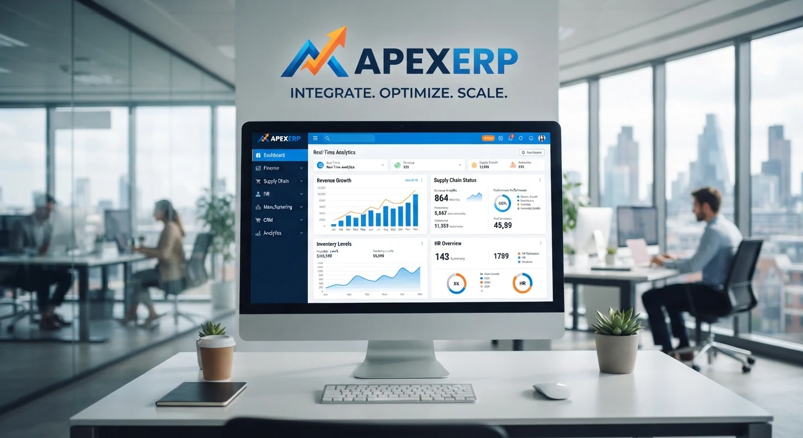

<p align="center">
  
</p>

<h1 align="center">ApexERP</h1>

<h3 align="center">Integrate. Optimize. Scale.</h3>

<p align="center">
  The multi-tenant, IFRS-compliant ERP platform for businesses, NGOs, and public sector institutions across Zimbabwe and the region.
</p>

<p align="center">
  <a href="https://apex-enterprise-ms.vercel.app"><b>Live demo</b></a> |
  <a href="#getting-started">Getting started</a> |
  <a href="#features">Features</a> |
  <a href="#financial-reporting">Financial reporting</a> |
  <a href="#regulatory-compliance">Compliance</a>
</p>

<p align="center">
  
  
  
  
  
</p>

<p align="center">
  <a href="https://github.com/munyaradzichiondegwa/ApexEnterpriseMS/actions/workflows/build.yml">
    
  </a>
</p>

---

## What is ApexERP?

> **ApexERP is an integrated, multi-tenant ERP platform that lets an organisation _integrate_ finance, operations, people, and compliance on a single ledger; _optimize_ how it runs, reports, and complies; and _scale_ from one company to a corporate group, an NGO portfolio, or a government institution.**

*Integrate. Optimize. Scale.* is more than a tagline. It describes how the platform is built.

| | What it means in ApexERP |
|---|---|
| **Integrate** | Every module posts through one double-entry engine (`GlPostingService`), so accounting, payroll, inventory, procurement, manufacturing, projects, grants, and public sector budgets all feed one set of books. Sales orders convert into AR invoices, payroll runs post to the GL, and inter-company transactions mirror automatically across group entities. |
| **Optimize** | Five IFRS statements are computed live from posted ledger data, not templated. Perpetual FIFO and AVCO costing, three-way matching, auto-matching bank reconciliation, multi-tier approval chains with SLA tracking, and real-time budget enforcement replace manual work. Zimbabwe tax and statutory rules (PAYE, NSSA, AIDS Levy, VAT, Withholding Tax, ZIMRA FDMS) are built in rather than bolted on. |
| **Scale** | Every business table is tenant-scoped, so many companies share one deployment with isolated data. Multi-entity consolidation, inter-company netting, and fund-centre and grant tagging take the same platform from a single SME to a group, an NGO, or a public sector body. The stack runs from one `docker compose up` to a hosted deployment. |

ApexERP runs real, working business logic across all 16 core ERP modules, not UI mockups. It uses a hybrid **ASP.NET Core 8 Web API + Next.js 14** architecture backed by **PostgreSQL 16**.

### Who it is for

- **Businesses:** general ledger, receivables and payables, inventory, manufacturing, payroll, CRM, fixed assets, and group consolidation.
- **NGOs:** grant and donor management, restriction tracking, indirect cost recovery, sub-awards, beneficiary registers, and donor financial reporting.
- **Public sector institutions:** Vote, Program, and Sub-Program fund hierarchy, commitment accounting, PPDPA e-tendering, and asset verification.

---

## Table of Contents

- [Live Demo](#live-demo)
- [Features](#features)
- [Financial Reporting](#financial-reporting)
- [Tech Stack](#tech-stack)
- [Architecture](#architecture)
- [Getting Started](#getting-started)
- [Security and Multi-Tenancy](#security-and-multi-tenancy)
- [Regulatory Compliance](#regulatory-compliance)
- [External Integrations](#external-integrations)
- [Development Status](#development-status)
- [Roadmap](#roadmap)
- [Contributing](#contributing)
- [License](#license)
- [Author](#author)

---

## Live Demo

The web application is deployed on Vercel: **[apex-enterprise-ms.vercel.app](https://apex-enterprise-ms.vercel.app)**

To explore the API as well, run the stack locally (see [Getting Started](#getting-started)) and open Swagger at `http://localhost:8080/swagger`.

---

## Features

### Financial Management and General Ledger

- Chart of accounts, cost centres, and accounting periods
- Shared double-entry posting engine (`GlPostingService`) used by every module. It validates debit/credit balance, enforces open-period rules, auto-numbers entries, maintains running balances, and supports reversal
- Inter-company mirroring: auto-creates a mirror AP invoice in a linked group company, with periodic netting and settlement
- Multi-entity consolidation: aggregates subsidiary trial balances, eliminates inter-company balances, and calculates non-controlling interest

### Accounts Receivable and Payable

- Customer and supplier invoicing with per-line VAT codes
- Receipting and payments with multi-invoice allocation
- Withholding tax calculation on non-compliant suppliers
- AR and AP ageing analysis (current / 30 / 60 / 90+)
- Fund-centre and grant tagging with real-time budget enforcement

### Cash and Bank

- Bank account management
- Statement import with auto-matching reconciliation (date +/- 3 days, exact amount) and manual reconciliation

### Inventory and Supply Chain

- Real perpetual **FIFO** and **AVCO** costing
- Purchase orders, goods receipt, and three-way matching
- Vendor management and low-stock alerts

### Manufacturing

- Bill of Materials with scrap factors
- Standard-cost roll-up
- Work order release and completion at actual cost

### Payroll and HR

- Employee and department management
- ZIMRA PAYE from database-stored tax bands, NSSA (3% employee / 3% employer), and AIDS Levy (3% of PAYE)
- Gross-to-net payroll runs with GL posting and payslip retrieval

### CRM and Sales

- Lead pipeline and opportunity tracking
- Sales orders that convert directly into draft AR invoices

### Project Management

- Grant-linkable projects, tasks, and timesheets with approval
- Budget-versus-actual tracking

### Fixed Assets

- Asset register with barcode/RFID tagging
- Straight-line and reducing-balance depreciation, run as a monthly batch
- IAS 16 revaluation to fair value, with disposal gain/loss

### Grants, Donors, and NGO Management

- Grant master with donor, award, and restriction tracking
- GL-account-level budgets with real-time over-budget blocking
- Indirect cost recovery and sub-award disbursement tracking
- Beneficiary and distribution registers, and donor financial reporting

### Public Sector and Government

- Vote / Program / Sub-Program fund hierarchy
- Commitment (encumbrance) accounting as a budgetary-control ledger, separate from the GAAP GL
- Real-time budget utilisation tracking with over-90%-used alerts and year-end carry-forward
- PPDPA e-tendering with server-side bid timestamping, late-bid rejection, and weighted evaluation scoring
- Barcode/RFID asset verification against the fixed asset register

### Platform Administration

- JWT authentication and role-based access control (RBAC)
- Multi-tenant company, user, and role administration
- Configurable multi-tier approval chain engine (up to 5 sequential tiers with per-tier SLA tracking), reusable across purchase orders, journal entries, payments, and more
- Immutable, append-only audit log across all modules

---

## Financial Reporting

Every statement below is computed live from posted ledger data, not templated. All five are available individually or in a single call via `GET /api/v1/reports/full-statement-pack`.

1. **Statement of Financial Position** (Balance Sheet)
2. **Statement of Profit or Loss and Other Comprehensive Income**, including a real OCI section (asset revaluation surplus and foreign operation translation reserve)
3. **Statement of Changes in Equity**, reconciling opening balance, profit transfer, OCI movement, dividends, and share capital movements to the Balance Sheet
4. **Statement of Cash Flows** (indirect method), with working-capital movements derived from `GlAccount.CashFlowCategory` tagging rather than hardcoded account codes
5. **Notes to the Financial Statements**: accounting policies, PPE movement schedule, inventory breakdown, AR/AP ageing, share capital movements, related-party disclosures, and IFRS 8 segment reporting

---

## Tech Stack

**Backend**

- ASP.NET Core 8, C#
- Entity Framework Core (versioned migrations)
- PostgreSQL 16
- JWT authentication, BCrypt password hashing
- Docker

**Frontend**

- Next.js 14 (App Router)
- React, TypeScript
- Tailwind CSS
- Axios
- Deployed on Vercel

**Infrastructure**

- Docker Compose (Postgres, API, and Web in one command)
- GitHub Actions CI (restore, build, migration check, frontend type-check and build)

---

## Architecture

```
ApexERP/
├── backend/                         ASP.NET Core 8 solution (C#)
│   ├── src/
│   │   ├── ApexERP.Domain/          Entities, enums (no dependencies)
│   │   ├── ApexERP.Application/     Services (business logic), Security (JWT/BCrypt)
│   │   ├── ApexERP.Infrastructure/  EF Core DbContext, tenant query filters
│   │   └── ApexERP.API/             Controllers, Program.cs, Dockerfile
│   └── database/
│       ├── schema.sql               Reference schema for manual bootstrap without the .NET SDK
│       └── seed.sql                 Zimbabwe chart of accounts, VAT/WHT codes, PAYE bands
├── frontend/                        Next.js 14 (App Router, TypeScript, Tailwind)
│   ├── app/                         One route per module (dashboard, gl, ar, ap, inventory, group, public-sector, grants, reports, ...)
│   ├── components/AppShell.tsx      Responsive sidebar (desktop) / hamburger drawer (mobile)
│   └── lib/                         Axios API client and auth context
├── scripts/                         Migration generation and smoke-test scripts
└── docker-compose.yml               Postgres, API, and Web, one command to run everything
```

**Integrate: the GL posting pattern.** No controller writes directly to `journal_entries` or `journal_lines`. Every module posts through `GlPostingService`, the single source of truth for balance validation, period-open checks, entry numbering, and account balance maintenance. Posted lines can carry a `FundCentreId` and/or `GrantId`, so one posting engine feeds the GAAP books, public sector budget-versus-actual, and donor reporting at the same time.

**Scale: multi-tenancy.** Every business table carries a `company_id`. EF Core global query filters, set per request by tenant middleware from the JWT, scope every query automatically. This is the application-level equivalent of PostgreSQL row-level security. Cross-tenant services (`InterCompanyService`, `ConsolidationService`) explicitly bypass those filters, since their job is to read and write across a company group. Each of their queries still filters explicitly by the relevant `companyId`.

**Frontend.** A responsive `AppShell` (persistent sidebar on desktop, hamburger-triggered drawer on mobile), proper `viewport` meta and theme colour, mobile-first Tailwind layouts, a PWA manifest with install icons, and horizontally scrolling data tables on narrow screens.

---

## Getting Started

### Prerequisites

- Docker Desktop
- .NET 8 SDK (for local backend development and migration generation)
- Node.js 20+
- PostgreSQL 16 (only if running outside Docker)

### Clone the repository

```bash
git clone https://github.com/munyaradzichiondegwa/ApexEnterpriseMS.git
cd ApexEnterpriseMS
```

### Quick start (Docker)

Generate the initial migration (one time, needs Docker and internet access):

```bash
# Windows PowerShell
.\scripts\generate-migrations.ps1

# macOS / Linux
./scripts/generate-migrations.sh
```

Then bring the stack up:

```bash
docker compose up --build
```

| Service    | URL                                                                                       |
|------------|-------------------------------------------------------------------------------------------|
| Web app    | [http://localhost:3000](http://localhost:3000)                                            |
| API        | [http://localhost:8080](http://localhost:8080)                                            |
| Swagger    | [http://localhost:8080/swagger](http://localhost:8080/swagger)                            |
| PostgreSQL | `localhost:5432` (`apexerp` / `apexerp_dev_password`, change before any real deployment)  |

**First run**

1. Open [localhost:3000/register](http://localhost:3000/register) and create your company and admin user. This seeds a Company, an Administrator role with full permissions, and your user.
2. Run `backend/database/seed.sql` against the new database (fill in your company UUID from the `companies` table) to load a starter Zimbabwe chart of accounts, VAT/WHT tax codes, and PAYE bands.

   > **Warning:** The PAYE bands in `seed.sql` are illustrative placeholders modelled on ZIMRA's tax-table structure. Verify and replace them with the exact bands from the current ZIMRA Public Notice before relying on them for real payroll.
3. Log in and start creating customers, suppliers, and inventory items, and posting transactions.

### Manual setup

**Backend**

```bash
cd backend
dotnet restore
dotnet build
dotnet run --project src/ApexERP.API
```

**Frontend**

```bash
cd frontend
npm install
npm run dev
```

### Database migrations

ApexERP uses real, versioned EF Core migrations rather than `EnsureCreated()` or hand-run SQL. Generate them once with the scripts above, commit the generated files, and every environment applies the same schema automatically from then on. Re-run the script with a descriptive name any time an entity class under `ApexERP.Domain/Entities` changes, for example:

```powershell
.\scripts\generate-migrations.ps1 -MigrationName AddCustomerLoyaltyPoints
```

`Program.cs` calls `db.Database.Migrate()` on startup, so `docker compose up` applies any pending migrations automatically. No manual `dotnet ef database update` step is needed once migrations exist.

---

## Security and Multi-Tenancy

- JWT authentication with `company_id` and role claims
- BCrypt password hashing
- Role-based access control (RBAC) enforced at the API layer
- Per-tenant data isolation via EF Core global query filters
- Immutable, append-only audit log
- Configurable multi-tier approval chain engine (up to 5 sequential tiers with per-tier SLA tracking)

---

## Regulatory Compliance

**IFRS**

- IAS 1: full five-statement presentation
- IAS 16: property, plant, and equipment revaluation to fair value, with the surplus recognised in OCI/equity

**Zimbabwe tax and statutory compliance**

- PAYE, calculated from database-stored ZIMRA tax bands
- NSSA contributions (3% employee / 3% employer)
- AIDS Levy (3% of PAYE)
- VAT and Withholding Tax with configurable tax codes
- Digital Services Tax (DST)
- ZIMRA FDMS fiscalisation: NIST P-256 ECDSA invoice signing, the 16-character MD5 QR digest ZIMRA's specification requires, and a 72-hour offline retry queue

---

## External Integrations

Each integration is isolated behind a service boundary, so a production credential or hardware connection drops in without touching business logic.

| Integration                                 | Status        | Notes                                                                                                         |
|---------------------------------------------|---------------|---------------------------------------------------------------------------------------------------------------|
| ZIMRA FDMS fiscal signing                   | Partial       | Crypto and offline queue implemented. A production device certificate requires ZIMRA registration.            |
| ZIMRA e-filing (VAT/PAYE portal submission) | Partial       | Calculations complete. The portal submission call is a placeholder.                                           |
| EcoCash / OneMoney / PayNow                 | Partial       | Payment methods modelled. Confirmation webhook not yet wired.                                                 |
| ZimSwitch direct debit                      | Not available | Bank statement CSV import with auto-matching is available instead.                                           |
| SMS OTP / TOTP two-factor auth              | Partial       | Fields exist on the user model. Verification flow not yet wired into login.                                   |
| Redis-backed refresh tokens                 | Planned       | Currently issued as signed JWTs. Redis-backed rotation planned.                                               |
| RabbitMQ / Hangfire scheduling              | Partial       | Payroll runs, depreciation batches, and FDMS retries are callable on demand via the API. Scheduling not yet wired. |
| PPDPA public e-tendering portal             | Partial       | Bid timestamping, late-bid rejection, and weighted scoring implemented. Public vendor self-registration site not built. |
| Barcode / RFID hardware                     | Partial       | Matching logic implemented. Physical scanner/reader integration pending.                                      |
| S3, Meilisearch, SignalR                    | Not available | Not yet implemented.                                                                                          |

---

## Development Status

The backend domain layer (60+ entities across all 16 modules) and the Next.js frontend (24 routes) both build cleanly. The Application, Infrastructure, and API layers depend on NuGet package restore, so run a full `dotnet build` in an environment with normal outbound access before deploying.

A GitHub Actions workflow (`.github/workflows/build.yml`) runs the full restore, build, and migration-check pipeline on push. `scripts/smoke-test.sh` provides a curl-based end-to-end check of the GL posting engine (register, post a journal entry, pull the trial balance).

`backend/database/schema.sql` mirrors the original 14-module core for anyone bootstrapping without the .NET SDK. It has not yet been updated for the Group, Public Sector, and Grants tables added since. The authoritative schema is always whatever `dotnet ef migrations` generates from `ApexERP.Domain/Entities`.

---

## Roadmap

- React Native mobile apps
- Predictive analytics and AI-assisted financial insights
- Full Playwright and xUnit automated test suites
- Workflow engine upgrade beyond the current generic approval model
- Redis-backed refresh-token rotation
- RabbitMQ/Hangfire scheduled automation for payroll, depreciation, and FDMS retries
- Public-facing vendor self-registration portal
- SMS OTP / TOTP two-factor authentication
- API marketplace

---

## Contributing

Contributions are welcome.

1. Fork the repository
2. Create a feature branch

   ```bash
   git checkout -b feature/new-feature
   ```
3. Commit your changes

   ```bash
   git commit -m "Add new feature"
   ```
4. Push the branch

   ```bash
   git push origin feature/new-feature
   ```
5. Open a pull request

---

## License

This project is licensed under the MIT License.

---

## Author

**Munyaradzi (Bloodshed) Chiondegwa**
Full-Stack Software Developer | Fintech, Governance, and Business Systems Specialist | Deaf Community Advocate

Munyaradzi holds an MBA and a BAcc (Hons) from Zimbabwe Open University, and an Associate of Applied Science in Software Development from BYU-Idaho. His work sits at the intersection of financial governance, regulatory compliance, and software engineering, building systems like ApexERP that combine accounting rigour with modern application architecture.

[](https://munyaradzichiondegwa.netlify.app/)
[](https://www.linkedin.com/in/munyaradzi-chiondegwa/)
[](https://github.com/munyaradzichiondegwa)
[](mailto:chiondegwabm@gmail.com)

---

<p align="center">
  <b>ApexERP: Integrate. Optimize. Scale.</b><br>
  Built with ASP.NET Core, PostgreSQL, and Next.js, for Zimbabwe, for Africa, and beyond.
</p>


